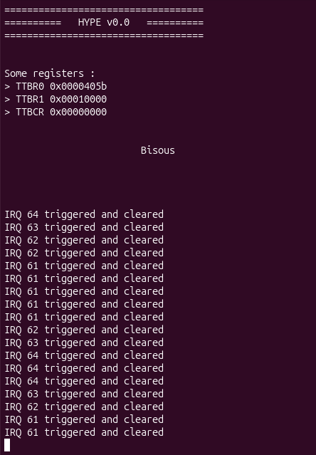

# Chapitre 1 - Interruptions

Ok, I can compile. I can boot and send over UART (though it's Xilinx code, not mine). Now, time to dig into interrupts, "external" (aka buttons) and internal (the tasty ones, clocks, memory error, and so on...).

## Back to asm

Basically, when an interrupt/exception is triggeredm some registers are saved/banked, then the code jumps to the entry in the vector table (typically at 0x0, but it can be mapped high at 0xFFFF_0000) corresponding to the interrupt :
|Vector offset|Exception|Mode|CPSR Mask|Return|
|-|-|-|-|-|
|0x00|Reset|Supervisor|F=1, I=1|-|
|0x04|Undefined instruction|Undef|I=1|`MOVS PC, R14` -> Next instruction|
|0x08|Supervisor Call|Supervisor|I=1|`MOVS PC, R14` -> Next instruction|
|0x0C|Prefectch Abort|Abort|I=1|`SUBS PC, R14, #4` -> Aborting instruction|
|0x10|Data Abort|Abort|I=1|`SUBS PC, R14, #8` -> Aborting instruction if precise|
|0x14|Not Used|Hyp|-|-|
|0x18|IRQ|IRQ|I=1|`SUBS PC, R14, #4` Next instruction|
|0x1C|FIQ|FIQ|F=1, I=1|`SUBS PC, R14, #4` Next instruction|

What I intended to do : use Xilinx functions to register a function that change the LEDs pattern when I hit a button. Did it work ? Obviously not. 

And well... ironically, looking more into the instruction being run at startup, I decided to go for boot code instead of interrupts. Because after all.... Boot code is the first thing that runs !

## Reworking the base

So... Best way to understand is to do, right ?

So here we are, makeing a boot.S that configures the CPU and CP15, initializes stack pointer and link return value, and here we go !

Oh, and I made a dummy exception vector table (for now).

Oh, and a very cool _exit loop. Ok, not really, but it's mine, **I** made the code jumps at the end of the main. No, seriously, I do feel a sizeable amount of pride in it.

```assembly
.org 0

.text

.globl _exit

.section ._exit,"ax"
_exit:
	b _exit

.end
```

To be honnest, the rest is more interesting. For instance, using AMD Xilinx UG-585, I got the useful register to send bytes over UART.

```C
static void _kprint_putchar(char c){
    volatile unsigned int *reg_uart_fifo_status = (void *)(XPAR_PS7_UART_1_BASEADDR + XUARTPS_SR_OFFSET);
    volatile unsigned int *reg_uart_fifo =        (void *)(XPAR_PS7_UART_1_BASEADDR + XUARTPS_FIFO_OFFSET);

    while(*reg_uart_fifo_status & XUARTPS_SR_TX_FULL_BIT)
        ; /* Wait for UART TX FIFO to be "not full" */
    *reg_uart_fifo = c; /* put char in UART TX FIFO*/
}

void _kprint(char *string){
    while(*string){
        _kprint_putchar(*string);
        string++; /* _kprint_putchar(*(string++)); in one line is meh */  
    }
}
```

The compiler used the keywork static to treat `_kprint_putchar` as an inlined function. Who am I to judge ? Actually, it' s just a few instructions, often repeated, so I'm glad it saved the jumps.

## Yes, but buttons iterrupts ?

So, button on the board are connected to the PL, then to the GIC lines 61 to 64. According to UG-585, that means I have to enable configure "something" in registers ICDICFR3[31:30] for button 0 at IRQ ID 61, and ICDIFR4[1:0], ICDIFR4[3:2], ICDIFR4[5:4] for buttons 1, 2, 3 at IRQ ID 62, 63, 64.

The two bytes ? No idea. Oh, and this :
> Targeting the CPU is done by the ICDIPTR [23:8] registers. The sensitivity of each SPI interrupt must be programmed to match those listed in Table 1, PS and PL Shared Peripheral Interrupts (SPI). The sensitivity is programmed using the ICDICFR [5:2] registers.

Xilinx doc is... well, it is what it is. **But** they mention the GIC component, pl390. Let's check the [online documentation](https://support.arm.com/documentation/ddi0416/b/) then....

Oh, but Altera did something (see [Resources](../Resources/)) ! Apero is calling, but let's try something.

## SCU, GIC, CPSR

So, to actually have your CPU recieve interrupts, you have to :
- Enable the SCU (SCU Control Register 0xF8F00000)
- Enable the GIC, and set the priority mask to allow all (for now)
  - By the way, priority and priority mask is 5 bits... oh, and not 0b11111, no... 0b11111000 = 0xF8, they are shifted 3 bits...
- Enable the signaling of the interrupts
- Enable the distribution of the interrupts
- Configure the distribution, per interrupt ID (let's call this '#id')
  - Enable interrupt #id (at the right spot of the correct ICDISERn register - 1 bit)
  - Set the interrupt priority (idem in a ICDIPRn register - 8 bits, but remember, it's masked by 0xF8)
  - Set the CPU to relay the interrupt (ICDIPTRn - 8 bits)
  - Set the sensitivity (edge = 1 or active = 0, in a ICDICFRn register - 2 bits, but only the higher bit has to be set)

Oh, and you can configure it somewhere to send FIQ or IRQ, but... Not today !

Good, now you just have to process it.
```assembly
IRQHandler:					    /* IRQ vector handler */
	push	{lr}
	bl		handle_irq
	pop 	{lr}
	subs	pc, lr, #4			/* adjust return */
```

To process it, it's actually pretty straightforward :
- Read GIC ICCIAR register to retrieve interrupt ID.
- Handle th sh*t out of it (I... printed something...)
- Write the interrupt ID to ICCEOIR register.

Recompile, flash, profit !



I know, the code is dirty, but for now I'm trying to make sense of things. Oh, and I'm pretty sure the blocking _kprint are taking most of the execution time. I guess profiling and other testing tools should be comming next.

But now that I have PL interrupts, and probably all the other ones though I didn't try them (should I make a code that purposedly hit an undefined instruction to trigger the associated exception ? Definitely ! Will I ? We'll see), next step is... Timers !

## Timed interrupts

So, from some official Xilinx documentation (rare enough to be mentionned, ain't it), I found what I was looking for !

GIC has a private timer for each CPU. It's plugged to GID interrupt line 29, and it's easy to configure.

The registers :
- REG_LOAD, 32b "load_value"
- REG_COUNT, counts down, hits #29 on 0
- REG_CONTROL, [15:8] prescaler, [2] : IRQ_enable, [1] : Auto_Reload, [0] : Timer enabled
- REG_STATUS, [0] is a sticky bit set to 1 if the timer has triggered, write 1 to reset

The timer runs at half the CPU frequency, divided by (prescaler + 1). It can automatically reload load_value, so yeah, I have what I want.

The right callback architecture, prescaler set to max 256, using xparameters.h `XPAR_CPU_CORTEXA9_0_CPU_CLK_FREQ_HZ` for CPU clock (I am not sure I can easily find the CPU actual frequency from within the Zynq-7000, because I guess it depends on external resonators or capacitors), and here we have it :

```C
void tic_setup(int ms_duration, void (*callback)(void *), void *param);
```

I set ms_duration to 10 ms, made a callback that counts 100 tics for a glorious second, and voila !


Another essential brick for the wall... hem... for the Hypervisor !
