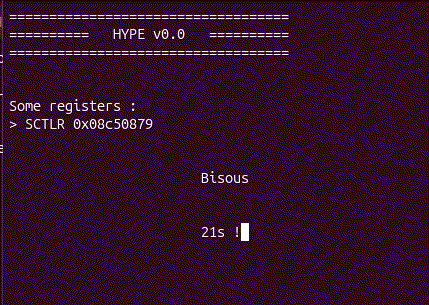

# Chapitre 1 - MMU

Time too look more into MMU, especially permission bits and how to maintain a kernel table vs app table.

## APX, AP1 and AP0

Table entries have these bits, they are about read/write permission (how about execute ?).

| APX   |	AP[1]	| AP[0]   |	Privileged	|   Unprivileged	| Description   |
| - | - | - | - | - | - |
| 0     |	0	| 0     |	No access	|   No access	    | Permission fault  |
| 0     |	0	| 1     |	Read/Write	|   No access	    | Privileged access only    |
| 0     |	1	| 0     |	Read/Write	|   Read	        | No user-mode write    |
| 0     |	1	| 1     |	Read/Write	|   Read/Write	    | Full access   |
| 1     |	0	| 0     |	~	        |   ~	            | Reserved  |
| 1     |	0	| 1     |	Read	    |   No access	    | Privileged Read only  |
| 1     |	1	| 0     |	Read	    |   Read	        | Read only |
| 1     |	1	| 1     |	~	        |   ~~	            | Reserved  |

APX is bit 15, AP[1:0] are bits [11:10], which give the bit mask 0x8C00. I looped over the given MMU table, checking these bits (and telling me where it changes), we have :

``` 
MMU Entry 0x00015de6 mask 0x00000c00
MMU Entry 0xc0000000 mask 0x00000000
MMU Entry 0xe0000c06 mask 0x00000c00
MMU Entry 0xe0300000 mask 0x00000000
MMU Entry 0xe1000c06 mask 0x00000c00
MMU Entry 0xe6000000 mask 0x00000000
MMU Entry 0xf8000c06 mask 0x00000c00
MMU Entry 0xf9000000 mask 0x00000000
MMU Entry 0xfc000c0a mask 0x00000c00
MMU Entry 0xfe000000 mask 0x00000000
MMU Entry 0xfff04c0e mask 0x00000c00
```

So basically, entries 0x0 to 0xC00 (excluded) have APX=0, AP1=AP0=1 (full access), then entries 0xC00 to 0xE00 (excluded) APX=AP1=AP0=0 (reserved), etc. How about table entries bits [1:0] ? 0b10 for full access entries, 0b00 for reserved.

How to mess with it (and enjoy it) ? I could make sure I have a DataAbortHandler that does something, modify a section to be readonly, reload the table, try to write a forbiden section, and be happy.  

## Make it crash

It's not that easy to have this fault... Because you need to make it readonly in the MMU. Ok, it's doable. Then you have to unmask async exception, by clearing bit A in CPSR. Oh, but when you try to write CPSR, the compiler sneakingly replaces `msr cpsr, r0` (move to special register CPSR from genneral register r0) by.... `msr cpsr_fc, r0`, updating only bits [31:24] and [7:0] ! So yeah, `msr cpsr_x, r0` to write bits [15:8]...

But. The MMU table configuration tags the sections with a 4 bits Domain ID (0:15), and the register DACR (Domain Access Control Register) marks each domains: 
- 0b00:"no access" (Fault)
- 0b01:"client" (Follow MMU AP bits permissions)
- 0b10:"reserved" (Unpredictable twilight zone)
- 0b11:"manager" (Ignore AP bits, do whatever you want)

And of course, this registers defaults to all 1s on reset...

So, I made Key 1 callback function try to write data to 0x100000, and Key 0 change MMU so that the section containing this address becomes read only. And....



Yeah.... Many things to do to make it fail graciously !

Personnal reminder : Domains, CPSR_[suffix:fsxc], TLB (cached table) ivalidation.

## Now what

I guess I'll have to... start thinking about making an actual hypervisor with actual processes doing actual things ? It terrifies me !
