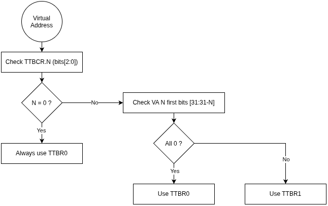
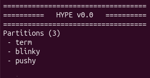
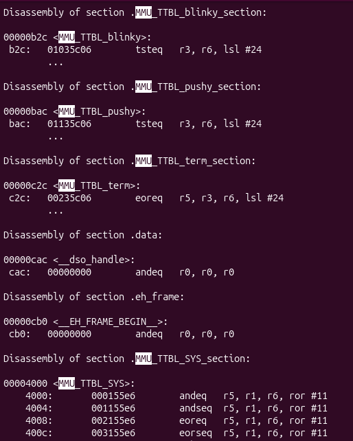
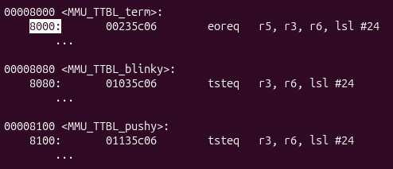

# Chapitre 3 - Hyp-0, Part 0

So, time to have usable configuration files and the first autogen Python scripts !

## The details of the configuration files

The platform configuration file is the "easier" to do. I has three sections:
- `platform` holding generic informations. I may rework it later with useful infom or just remove it.
- `memory` describing the system memory map
- `drivers` listing couples of ID (system call id) name

```yaml
---
platform:
  name: Zynq-7000

memory:
  total_size: 0x100000000
  section_size: 0x100000
  map:
  - name: OCM
    addr_start: 0x0
    addr_end: 0x3FFFF
    domain: 0xF
    S: 1
    tex: 0b101
    C: 0
    B: 1
  - name: DDR
    addr_start: 0x10000
    addr_end: 0x3FFFFFFF
    domain: 0xF
    S: 1
    tex: 0b101
    C: 0
    B: 1
  - name: PL-slave0
    addr_start: 0x40000000
    addr_end: 0x7FFFFFFF
    S: 0
    tex: 0
    C: 0
    B: 0
    [...]

drivers:
  - name: uart_send
    id: 0
  - name : uart_receive
    id: 1 
  - name : get_time
    id: 2 
  - name : btn_read
    id: 3 
```

From this, I've managed to make a script that generates and MMU equivalent to the *translation_table.S* provided by Xilinx. 

But now, I have to make sense of the project configuration file, especially memory mapping the partitions. For now, let's try having one section per partition, and a simple two parameters mapping (it will be more complicated later) :
- `len` : the length of the allocated segment
- `pa_start` : the first Physical Address (actual HW location).


```yaml
---
partitions:
  - term :
      id: 0
      descr: "Terminal for user interaction"
      mmap:
        len:      0x100000
        pa_start: 0x200000
      permissions:
        - uart_receive
        - uart_send
        - get_time

  - blinky:
      id: 1
      descr: "Periodically blinks LEDs"
      mmap:
        len:      0x100000
        pa_start: 0x1000000
      permissions:
        - get_time

  - pushy:
      id: 2
      descr: "When a button has been pressed, prints something"
      mmap:
        len:      0x100000
        pa_start: 0x1100000
      permissions:
        - uart_send
        - btn_read
```

Now, to make it useful, I'll have to juggle with tables, and registers. A bit more on tables. The MMU uses three registers to manage tables. TTBCR (Control Register), and TTBR0 and TTBR1.



This allows to have a main table addressing the whole 4GB, pointed by TTRB1, restricting access to PL1, and give partitions a small table, for addresses in the range 0 to 2^(31-n), pointed by TTRB0. 

N | TTBR0 address len (B) | TTBR0 address len | TTRB0 table size
-- | -- | -- | --
0 | 0x1_0000_0000 | 4 GB | 16 kB (0x1000 entries)
1 | 0x8000_0000 | 2 GB | 8 kB (0x800 entries)
2 | 0x4000_0000 | 1 GB | 4 kB (0x400 entries)
3 | 0x2000_0000 | 512 MB | 2 kB (0x200 entries)
4 | 0x1000_0000 | 256 MB | 1 kB (0x100 entries)
5 | 0x0800_0000 | 128 MB | 512 B (0x80 entries)
6 | 0x0400_0000 | 64 MB | 256 B (0x40 entries)
7 | 0x0200_0000 | 32 MB | 128 B (0x20 entries)

So... I'll start with small partitions, set N to 7, build a small Level 1 table with one entry, give no less than 1MB (eat that Sam Altman - people from the future, it's november 2026 and OpenAI CEO complains people have to much RAM at home rather than in their datacents). After giving it some thought, I will not reduce this to less than 1MB using Level 2 table.

Also, the smaller table have a smaller memory alignment requirement. So if N=3, the table is 2kB long with a 2kB alignment requirement.

## Let's put this together

I've put up a Python script, `process_config.py`, to process config files and template files into... actual code ! That compiles ! And runs !

First step makes .S files for the tables. From the following template :

```assembly
.globl /*%%MMU_TABLE_NAME%%*/
.section ./*%%MMU_TABLE_NAME%%*/_section,"a"
/*%%MMU_TABLE_NAME%%*/:

/*%%MMU_TABLE_CONTENT%%*/

.end
```

To the following file :

```assembly
.globl MMU_TTBL_SYS
.section .MMU_TTBL_SYS_section,"a"
MMU_TTBL_SYS:

	.word	0x000155E6	/* OCM, S=1, tex=5, B=1, C=0, apx=0, ap=1 */
	.word	0x001155E6	/* DDR, S=1, tex=5, B=1, C=0, apx=0, ap=1 */
	.word	0x002155E6	/* DDR, S=1, tex=5, B=1, C=0, apx=0, ap=1 */
  /* ... */
.end
```

And then make C code that refers to these, from the template :

```C
#include "partitions_configuration.h"

/*%%EXTERN_REF_TO_TABLES%%*/

const struct hype_partition_descriptor hype_partitions[] = {
/*%%PARTITIONS_ENTRIES%%*/
};

const unsigned int hype_partitions_count = /*%%PARTITIONS_COUNT%%*/;
```

To something like :
```C
#include "partitions_configuration.h"

extern const char MMU_TTBL_term[];
extern const char MMU_TTBL_blinky[];
extern const char MMU_TTBL_pushy[];

const struct hype_partition_descriptor hype_partitions[] = {
    {
        .name = "term",
        .mmu_table_loc = MMU_TTBL_term
    },
    {
        .name = "blinky",
        .mmu_table_loc = MMU_TTBL_blinky
    },
    {
        .name = "pushy",
        .mmu_table_loc = MMU_TTBL_pushy
    },
};

const unsigned int hype_partitions_count = 3;
```

The files are generated into an `autogen` folder, that is referrenced during kernel compilation. 

```bash
$ tree -d .
.
├── conftool
│   ├── configs
│   └── templates
└── kernel
    ├── arm
    │   ├── hw
    │   ├── include
    │   └── lib
    ├── autogen
    │   ├── include
    │   └── src
    └── boot
        ├── include
        ├── obj
        └── src
```

Then, in boot/src/main.c :
```C
#include "partitions_configuration.h"
/*...*/
int main(){
    /*...*/
    _kprint("Partitions (");
    _kprint_i32dec(hype_partitions_count);
    _kprint(")\n\r");
    for(int i = 0; i < hype_partitions_count; i++){
        _kprint(" - ");
        _kprint(hype_partitions[i].name);
        _kprint("\n\r");
    }
}
```

And...



This display (almost first try, jklol) litteraly got my eyes wet.

Oh, and the MMU Tables are in boot.elf, but....



The alignment is wrong (but the addresses are funny, B2C, C2C, Bac...)

So... some generated linker script for data alignment ? Here we go... 

```
.MMU_section : {
   . = ALIGN(16384);
   *(.MMU_TTBL_SYS_section)
   INCLUDE MMU_lscript.ld
} > ps7_ocm_0
```

That includes the generated aligned sections :

```
   . = ALIGN(128);
   *(.MMU_TTBL_term_section)
   . = ALIGN(128);
   *(.MMU_TTBL_blinky_section)
   . = ALIGN(128);
   *(.MMU_TTBL_pushy_section)
```

And... it works ! Look at this beautiful 128/0x80-byte alignment ! Oh, the feeling of accomplishment!




## Next

Well, I don't know yet, see for yourself ! [Chapter 3, part 1](./Chap3-1.md)
