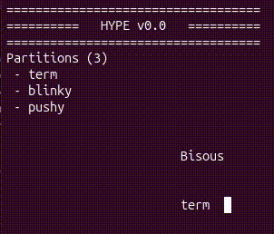

# Chapitre 3 - Hyp-0, Part 1

It works! I'm not sure it's the best way to do it, but it works. I mean, I can turn config files into useable code. And now, for my next trick...

I've configured space (memory), time to configure time.

## Schedule

The format will be something like this:

```yaml
shedule:
  period_ms: 1000
  cpu0:
    - partition: 0
      from_ms: 0
      to_ms: 800
    - partition: 2
      from_ms: 800
      to_ms: 900
    - partition: 1
      from_ms: 900
      to_ms: 1000
```

I define a period of 1 second, which is going to repeat for ever (well...). And within each period, partition 0 (`term`) will run from ms 0 to ms 800, then partition 2 (`pushy`) runs from ms 800 to ms 900, then partition 1 (`blinky`) from ms 900 to ms 1000, the end of the period, then again parttion 0, 2, 1 etc.

Add this to `partitions_configuration.c` :
```c
const struct hype_scheduling_slot hype_scheduling[] = {
    {
        .partition_id = 0,
        .from_ms = 0,
        .to_ms = 800
    },
    {
        .partition_id = 2,
        .from_ms = 800,
        .to_ms = 900
    },
    {
        .partition_id = 1,
        .from_ms = 900,
        .to_ms = 1000
    },
};

const unsigned int hype_scheduling_count = 3;
```

And a function to use it in my main. Basically, I configure the CPU0 private timer to give me a *tic* every ms, and on each tic, I increase a local counter, test if I've reached the end of the current slot, if so, move to the next slot (or loop to the first slot if we' ve reached the end of the loop). On slot changes, I print the name of the new partition.

```c
struct scheduler_status {
    unsigned int current_ms;
    unsigned int current_slot;
} scheduler_status;

void scheduler(void *param){
    struct scheduler_status *sched_status = (struct scheduler_status *) param;

    sched_status->current_ms += 1;
    if(sched_status->current_ms == hype_scheduling[sched_status->current_slot].to_ms){
        sched_status->current_slot++;
        if(sched_status->current_slot == hype_scheduling_count){
            sched_status->current_slot = 0;
            sched_status->current_ms = 0;
        }
        _kprint("\033[13;25H");
        _kprint(hype_partitions[hype_scheduling[sched_status->current_slot].partition_id].name);
        _kprint("  ");
    }
}
```

And then, just parameters initialization and function registration! I initualize the parameters so the first tic triggers a loop back to the first slot. 
```c
    scheduler_status = (struct scheduler_status){
        .current_ms = hype_scheduling[hype_scheduling_count].to_ms - 1,
        .current_slot = hype_scheduling_count - 1
    };
    tic_setup(1, scheduler, &scheduler_status);
```


