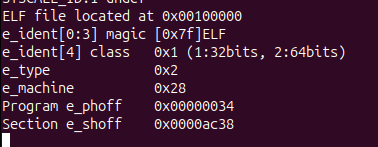
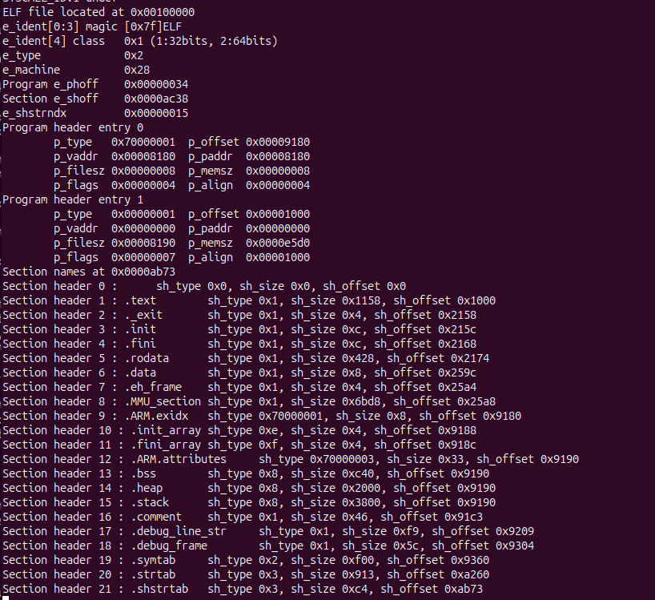
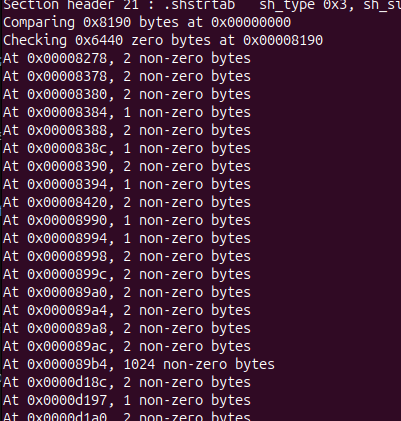
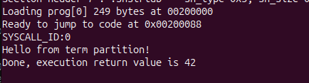

# Chapitre 3 - Hyp-0, Part 3

I think I have some drivers (that I may rework a bit later). But, elf files

## Inspecting some onboard ELF file

In the previous section, I described the elf general header. Well, let's download an lef file to the board, and use Hyp-0 to inspect it.

Now, the clean way to do it will probably be to package someway, and tell the kernel where it is stored. For now... I've chosen to just use `xsdb` to download my `boot.elf` as raw data at address 0x100000 in `JTAG_prog.tcl`

```tcl
# Send actual ELF to memory (using CPU0, I guess)
targets -set -nocase -filter {name =~ "*A9*#0"}
dow ./kernel/boot/obj/boot.elf
configparams force-mem-access 0

dow -data {./kernel/boot/obj/boot.elf} 0x100000

# Starts CPU0
con
```

And just casting that address as apointer to a header struct, I get some display!

```c
void print_elf_header(struct elf_header *header){
    _kprintf("ELF file located at 0x%p\n\r", (unsigned int)header);
    _kprintf("e_ident[0:3] magic [0x%x]%c%c%c\n\r", (int)header->e_ident[0], header->e_ident[1], header->e_ident[2], header->e_ident[3]);
    _kprintf("e_ident[4] class   0x%x (1:32bits, 2:64bits)\n\r", (int)header->e_ident[4]);
    _kprintf("e_type             0x%x\n\r", (int)header->e_type);
    _kprintf("e_machine          0x%x\n\r", (int)header->e_machine);
    _kprintf("Program e_phoff    0x%p\n\r", (int)header->e_phoff);
    _kprintf("Section e_shoff    0x%p\n\r", (int)header->e_shoff);
}

int main(){
    /* ... */
    struct elf_header *header = (struct elf_header *) 0x100000;
    print_elf_header(header);
}
```

And that... works!



So, let's check program and sections headers, and voila!



## Recipe vs result

Before I try to load a partition elf, I want to compare what I understand from the ELF format with what xsdb does when it runs the command to download the elf file to the card.

Wikipedia entry describes the program header section as follows : _The program header table tells the operating system how to create a process image._ Let's start there. A program section can be of various types, but we just have 0x70000001 and 0x00000001, which are respectively an ARM specific program related to exception handling and a loadable segment. Let's treat them both as Loadable for now.

Program entry 0 tells us that starting offset 0x00009180 in the elf file should be loaded at virtual/physical address 0x00008180, 8 bytes into 8 bytes of memory (no zero-padding).

Program entry 1 tells us that starting offset 0x00001000 in the elf file should be loaded at virtual/physical address 0x00000000, 0x00008190 bytes into 0x000e5d0 bytes of memory (zero-padded).

So, we'll ignore the first entry, and compare the content of program entry 1 to what is present in the ram.



So, looks bright! The loaded section is the same as what's in the RAM! I thought they would be some difference, but nope! Good! The rest... I don't know if xsdb zeroed it and it got modified during the execution, or if it comes from startup ram noise. Meh, the first part is actually already a victory! 

One particular section of the non-zero section is that 1024 block at 0x000089b4... My uart_send buffer data? 

Looking at the assembly of __uart_init() :
```assembly
00000d7c <__uart_init>:
    movw    r0, #35232      @ 0x89a0
    push    {r4, lr}
    movt    r0, #0
    mov     r2, #1024       @ 0x400
    add     r1, r0, #20
    bl      df0 <buffer_init>
```
And comparing to the signature of buffer_init
```c
int buffer_init(struct rolling_buffer *buffer, char *data, unsigned len);
```
R0 (decimal 35232) maps to the struct rolling_buffer pointer, and r1 (decimal 35232 + 20 0x89b4!) to the data. I could read the trash that is there and get the last 1024 printed bytes. But well deal with hacking the kernel later, prehaps? 

But it does confirm the "memory used to store variables" theory. I like that. What remains to be done? Unfortunately, everything!

## Elves

So, let's cook our own ELF and take look at it? 

Yes, but for that, I've had to once again rework my folder... 
```bash
$ tree -d
.
├── autogen
│   ├── kernel
│   │   ├── include
│   │   └── src
│   └── partitions
│       ├── include
│       └── src
├── conftool
│   ├── configs
│   └── templates
├── drivers
│   ├── call
│   │   ├── include
│   │   └── src
│   ├── gpio
│   ├── time
│   └── uart
│       ├── include
│       └── src
├── kernel
│   ├── arm
│   │   ├── hw
│   │   ├── include
│   │   └── lib
│   └── boot
│       ├── include
│       ├── obj
│       └── src
└── partitions
    ├── blinky
    ├── pushy
    └── term
```

Using tools in conftoofs populates autogen folder sources and headers. Then drivers compilation compiles and export to drivers/exports. Then autogen and kernel are compiled. Then you can compile partitions.

But like this, I can compile `term` partition with system calls properly defined. For now, its code is very simple:
```c
#include "drivers.h"

int strlen(const char *str){
    int res = 0;
    while (*(str++))
    {
        res++;
    }
    return res;
}

void print(const char *str){
    uart_send(str, strlen(str));
}

int main(){
    print("Hello from term partition!\n\r");
    return 42;
}
```
How to test it? I'll try to load the elf at 0x100000, then... then I don't want to set MMU for now so I've made a linker script to generate code that should load at 0x200000 RAM address.

```
MEMORY
{
   RAM_allocated : ORIGIN = 0x200000, LENGTH = 0x100000
}

ENTRY(main)

SECTIONS
{
    .text : {
        *(.text)
    } > RAM_allocated
}
```

Then, I just (right?) have to load the code according to the ELF information, push link return register, and jump to entrypoint!

It almost worked first time (hahaha, help me), for the following ([sourced](https://support.arm.com/documentation/dui0472/m/Using-the-Inline-and-Embedded-Assemblers-of-the-ARM-Compiler/Inline-assembler-instruction-restrictions-in-C-and-C---code?lang=en)) reason:
> There are a number of instructions that the inline assembler does not support.
>
> Specifically, the following instructions are not supported:
>
> BKPT, BX, BXJ, and BLX instructions.

For safety reason I've heard, but I'm a dangerous person! So, instead of C inline assembly, I made a function in a .S (called `hackjump`).



It grnblnbml worked! 

## Next

Before we move forward, let me repeat myself. IT. WORKED. I've developped code for a while, but for the first time in my life, I've made a program that configures some hardware, then loads and runs another program, independantly compiled. AND. IT. WORKED.

Next is going to be about configuring the MMU for a specific process, and then a better packaging of partitions. And then, Hyp-0 is done? 
