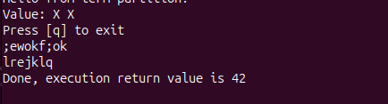
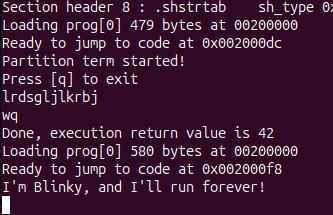

# Chapitre 3 - Hyp-0, Part 4

In the previous chapter, I talkedended on a note stating I'll be taking two steps to get Hyp-0 ready: understanding better the MMU, and a better partition packaging. I've kind of changed my mind, and I'll try to do things a bit differently. And first, I want to enrich my drivers a little, with:
- led_read
- led_write
- time_get
- uart_read

## More drivers

### LED read/write

Both operations use a bit mask, and a value. 

```c
int led_read(int * value, int * mask);
int led_write(int value, int mask);
```
After a call to `led_read`:
- the n-th bit of `value` is 1 if the n-th led is on, 0 otherwise;
- the n-th bit of `mask` is 1 if the n-th 'exists', 0 otherwise.

E.g is `value` is 0x5=0b0101 and `mask` is 0xF=0b1111, it means that there are 4 available leds, and led 0 and 2 are on,

Similarly, when calling `led_write`:
- if the n-th bit of value is 1 and the n-th bit of mask is 1, the n-th led is turned on;
- if the n-th bit of value is 0 and the n-th bit of mask is 1, the n-th led is turned off;
- if the n-th bit of mask is 0, the n-th led remains either on or off, depending on previous state.

It's working, but I'm lazy to take a picture of my board with the lights on. Not trusting me? Ok.

### UART Receive

Ok, this one will be a bit more tricky I guess. But the idea will be:
- set a recv_buffer SW buffer for reception;
- activate UART RX interrupt;
- on interrupt, check if TX empty and send_buffer has data vs RX not empty;
- if RX recv_buffer is not empty on uart_read call, copy data to "user" buffer.

Let's... do this?

After a while, I can read inputs:



### Time

Ok, last piece of driver. I'll have to get another HW timer to increment an uptime counter (microseconds and seconds). Here we here we go.

Version 0 of this is actually a couple of counter that increments when I call `time_get`. So the first call will return (0, 0), then (0, 1) etc.

It worked from the partition point of view, but it's obiously wrong. And since the "proof of success" involved me looking at blinking LED... Anyways, back to timer setup!

After struggling with a TTC (Triple Timer Counter), and its annoying IRQ handling (clear on read), I just went with simple on-demand uint64 arithmetics on the Global Timer 64 bits counter. 

Then again, according to the blinking frequency of the LEDs that I can visually see from being physically in front of my board, it's a success.

### We good?

Yes, we are. The margin for improvement is immense, but it'll do for now. After a bit of uncrustifying ([uncrustify](https://github.com/uncrustify/uncrustify) is a linter/code beautifier), back to hosting partitions!

## ARMv7 context elements

AFAIK, to properly define context and thus handle context switches, each partition will have:
- General purpose registers R1-R11 + IP, SP, LR and PC
- CPSR
- MMU Table(s)

Additionnaly, I'll proabably need to keep track of where the elf files actually are in a proper array, along with their size, and a checksum of some sort? Ok, the last one is more of a QoL kind of thing, but I should definitely start working on a tool to package partitions together and add a header.

### The cast

To keep things simple, the three partitions will be a bit different:
- term: still the same, echoes uart char until `q` is press;
- blinky: blinks leds 2 and 3 at 4Hz;
- pushy: blinks leds 0 and 1 at 3Hz.

Like this, I can visually confirm that blinky and pushy do more or less what they should, and keep playing with term (even though... I'm not sure I should keep the `q` key behaviour... We'll see...).

Oh, and I got the boot code to run two elf sequentially! I started term, got the return value, then started the endless loop of blinky!  



### The partitions binary

Header is:
- Magic key 'Hyp0Part' (8 bytes)
- N, number of entries (unsigned int, 8 bytes)
- The N entries:
  - Offset of entry name in binary
  - Offset of Elf file in binary
  - Size of Elf file in binary

Followed by a section containing the names of the partitions, then the partitions!

Looks sound, let's upgrade the config tool to make sort of a recipe file with the partitions id and names, and the script that turns this and the elfs into a partitions.bin! 
