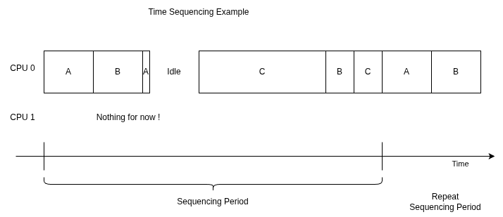

# Chapitre 3 - Hype, version 0

Is this it ? Probably. Now things have to get real, and I have to make... **Hyp-0** (Hype v0, and it sounds like hypo- which in greek means under... because it will be under-?-ing) ! Single core, basic drivers (uart send/receive, get system uptime), shared memories but no synchronization (race conditions lottery incoming).

Bonus : some unit tests in kernel HW independant functions, better formatted code ([uncrustify](https://github.com/uncrustify/uncrustify)).

## Architecture

Back to the basics of an hypervisor. 

### Space partitioning

Processes have a virtual address space, usually linear, that is translated by the MMU to a physical address space (can be fragmented). The MMU manages the read/write permission, as well as some other caching/sharing properties (single process/core access this vs shared memory) and prefetching properties (for instance, speculative fetching of an address mapped to a device can have side effects, so it should be prevented). This is space partitioning, and will be statically (compile time) defined here.

### Time partitioning

In a regular OS, processes CPU time is managed in a complex and smart way, that tends to optimize CPU load (for instance let process A waiting for a resource sleep until the resource is vailable, or allocate process A 30% of the time and B process B 70% of the time based on priority settings).

Here, no. It's going to be a straightforward deterministic compile time set way.

At compile time, we define when each process (or partition) is going to run. Oh, and while we're doing nothing, I think Cortex-A9 cores have WFE/WFI (Wait For Event/Interrupt) instructions that help save power. Not that it's an issue here, but it feels like a nice to have ?

So, this is not smart, and if in the middle of the previous example process C is done or starved in the middle of its slots, too bad, B can't start early.

### Interacting with the kernel (drivers, IPCs)

Well... That is... For now, I just have in mind a couple of drivers that return uptime (granularity TBD), push text to the UART send buffer, pop text from the UART receive buffer. I guess I'll have to implement three "system calls", and proper return codes... and some errno mecanism... Oh dear !

When a process use a `hype_xxx` function (declared in an upcoming header file, implementend in an upcoming static library file), it gets translated to the corresponding system call, which throws a SWI (SoftWare Interrupt) to go to kernel mode. The SWI handler checks if the process has the correct permission (according to configuration of the hypervisor), calls the corresponding system call handler which performs the task, and.... voila ? 

### Side note

It took me some time to write these. I have no idea how long this will take to make a working Hyp-0 !

## Configuration

### Configuration files

For now, it will be two YAML configuration files :
- platform.yml : should not be modified, it lists the drivers and system memory map.
- config.yml : the actual configuration file defining : 
  - The partitions
  - The partitions' driver accesses
  - The partitions' memory mapping
  - The scheduling plan (period length and partitions' slices)

### Configuration to business

Then scripts will :
- Check the coherency (unscheduled partitions, overlapping time slices or memories)
- Generates the MMU translations tables (system TTBL0 and per partitions TTBL1)
- Generates the per partition linker script
- Generates a header file for the scheduler's configuration
- Generates the final linker script

## Compilation

Now, it's not just about a Kernel. So we'll have to compile the kernel and a static library for system calls, then compile our partitions into .elf files (so we can check things, I guess), then link the kernel and the partitions together !

Easy ! Hahaha, help me !

## Hyp-0 boot

The boot sequence is :
- CPU general setup
- Check and load the partitions to their expected memories locations
- Setup the scheduler
- Run the scheduler !

## Parts

This chapter is actually so huge that I'll split into parts

[Part 0 - Configuration](./Chap3-0.md) 

[Part 0 - Scheduler](./Chap3-1.md) 

